# Local research prototype threat model

Scope: existing synthetic/public-mock data and loopback-only demonstration. This is a developer security analysis, not an external audit or real-patient deployment authorization.

```mermaid
flowchart LR
  MIC[Browser audio / selected mock file] --> PCM[Bounded PCM capture]
  PCM --> IDB[IndexedDB recovery chunks]
  PCM --> UP[Hashed resumable uploads / live prefixes]
  UP --> WORK[Leased worker / bounded temporary files]
  WORK --> TX[Immutable transcript and original audio identity]
  TX --> FACT[Exact evidence spans / unreviewed facts]
  FACT --> MODEL[Optional local model proposals]
  MODEL --> VERIFY[Independent deterministic checks / optional model opinions]
  FACT --> VERIFY
  VERIFY --> NOTE[Immutable reviewed note version]
  NOTE --> APPROVE[Current-source exact-version approval]
  APPROVE --> EXPORT[Escaped Markdown / text / JSON / FHIR]
  NOTE --> AUDIT[Content-free audit events / local chain]
  WORK --> AUDIT
  APPROVE --> AUDIT
  TX --> BACKUP[Protected synthetic backups / optional encryption drill]
  IDB --> RECOVER[Explicitly authorized recovery]
  RECOVER --> UP
```

| Boundary / asset | Threat | Implemented control / evidence | Residual limitation |
| --- | --- | --- | --- |
| Browser microphone and IndexedDB | wrong device, quota, disconnect, stale recovered chunks | explicit recording authorization, device capability/signal checks, bounded durable chunks, generation guards, explicit recovery confirmation | generated-signal tests do not validate physical routing; browser storage is not institution-managed encryption |
| Live prefixes / resumable upload | replay, wrong offsets, dropped ACK, extra tails, changed audio | digests/offset checks, idempotency, sealed final hashes and source lineage | requires controlled failure/recovery validation on each actual device |
| API requests | identity guessing, cross-role writes, oversized/deep/duplicate JSON | tenant/clinician predicates, read-only viewer enforcement, explicit route policies, bounded strict parsing | local access keys are development credentials, not verified professional identity |
| Cookie sessions / optional Google flow | login CSRF, replay, forged tokens, expired/revoked accounts | state binding, PKCE, nonce/signature/audience/issuer checks, Origin/CSRF, invitations, expiry and revocation simulation tests | offline profile forbids live OAuth; no new registration or hosted activation is performed |
| Workers / temporary files | stale lease, revoked processing, altered source, resource contention | lease/checkpoint fences, source digests, serialized model admission, late-publication checks | native processes are not OS-network-sandboxed by the Python guard; memory quotas require separate measurements |
| Prompts and model output | prompt injection, invented evidence, parser bombs, silent omission | untrusted-source prompts, schema/citation checks, bounded JSON, deterministic coverage and contradiction checks | rule tests are synthetic; local models are unvalidated and can fail or omit content |
| Notes / verification / approvals | corrupted body, stale source, fake approval, missing audit | typed hash-checked records, immutable versions, exact-version approval, local audit/approval seals | a privileged owner who rewrites all local database/seal state is not defeated by a local chain |
| Exports | active markup, wrong approval, corrupted stored artifact | escaped Markdown, exact JSON/FHIR attachment, source attribution, artifact hashes and approval-seal verification | recipient-specific EHR profile validation and external delivery are not established |
| Logs / source / reports | leaked audio, note text, secrets or cookies | sanitized error codes, content-free audit metadata, redacted pattern/known-key scanner | scanner coverage is finite; local browser traces and ignored config/backup files remain sensitive |
| Backups and deletion | plaintext copies, obsolete auth sessions, lost source, expired live prefixes | existing protected-backup/encryption/restore and retention test paths; authenticated deletion requests and legal-hold gates | institutional custody, retention approval and deletion of every external copy are unavailable |

P0 release blockers are unsafe auto-approval, identity/tenant leakage, missing audit attribution and corrupted evidence. Clinical release stays `BLOCKED_EXTERNAL_EVIDENCE_REQUIRED`. No newly obtained data, account, model weights, paid API or independent human sign-off is part of this assessment.
