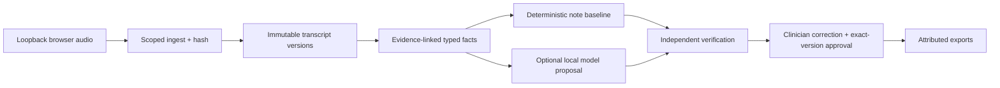

# Product architecture and evidence map

This page is the investor-demo architecture map for the local-first prototype.

## Implementation module map and contracts

This table names current implementation boundaries. The cited Python and
TypeScript modules are authoritative; the architecture diagrams above describe
intended flow, not proof that every optional model path is enabled in a given
deployment.

| Boundary | Current implementation | Responsibility and key contract |
|---|---|---|
| Browser workspace | `apps/clinician-web/src/hooks/useEncounterWorkspace.ts`, `apps/clinician-web/src/screens/` | Authenticated encounter state, source playback, proposed facts/notes, clinician edits and approval actions. `workspaceTypes.ts` mirrors the API response shape. |
| API composition and identity | `services/api/main.py`, `services/api/auth.py`, `services/api/contracts.py` | `create_app` composes routes and storage. Identity is tenant/clinician scoped. `EncounterInput`, `AuthorizationInput`, `UploadInput`, and `TranscriptionInput` reject unknown fields and constrain supported workflow. |
| Encounter and audio routes | `services/api/routers/encounters.py`, `services/api/routers/authorizations.py`, `services/api/routers/audio.py`, `services/api/routers/jobs.py` | Create synthetic-only encounters, record scoped processing permission, reserve/upload/seal audio, enqueue work, and expose bounded job status/retry/cancel operations. |
| ASR worker and transcript | `services/asr/worker.py`, `services/asr/profiles.py`, `services/asr/adapter.py`, `services/asr/transcripts.py`, `services/api/routers/transcripts.py` | Admits a configured local profile, processes an authorized sealed asset, and appends a timestamped transcript version with provenance. Provider failures remain explicit. |
| Review composition | `services/review/routes.py`, `services/review/service.py`, `services/review/routers/` | Registers workspace, proposal, note, verification, approval, amendment, export and history routes over shared scoped services. |
| Clinical facts and evidence | `services/review/models.py`, `services/review/clinical.py`, `services/review/relationships.py` | `Evidence` binds a quote to exact character offsets in a segment; `Fact` carries clinical assertion, subject, temporality, status and optional relations. `FactRelation` names the typed relationship. Unknown/uncertain fields remain explicit. |
| Drafting and verification | `services/review/providers.py`, `services/review/engine.py`, `services/review/clinical_models.py` | Deterministic drafting is the baseline. Optional local or hosted providers create proposals. Verification emits findings and gates; a model verdict cannot approve a note. |
| Approval, export and history | `services/review/routers/approvals.py`, `services/review/routers/exports.py`, `services/review/routers/history.py` | `ApprovalInput` binds approval to exact note/transcript/verification state. `ExportInput` requires that approval. Amendments and audit events preserve version history. |
| Persistence and integrity | `services/api/storage.py`, `services/api/postgres.py`, `services/api/record_integrity.py`, `services/audit_integrity.py` | SQLite is the local store; PostgreSQL is an optional configured backend. Database metadata and file/audio content have separate integrity and retention paths. |
| Evaluation and admission | `services/master_ledger.py`, `services/offline_acceptance.py`, `services/asr/admission.py`, `evaluation/` | Frozen dataset manifests and report hashes are kept separately from application inference. Admission and release status require evidence; benchmark rank alone does not select or clinically authorize a model. |

### Core data-contract transitions

1. **Encounter request:** `EncounterInput` carries an opaque patient reference,
   explicit identifier confirmation, English language, timezone, supported
   workflow/mode and `synthetic_data=true`.
2. **Processing permission:** `AuthorizationInput` records allowed scopes,
   policy version, method and timezone-aware expiry. Revocation blocks later
   processing.
3. **Audio source:** `UploadInput` binds declared byte count, media type and
   SHA-256. Sealing verifies received bytes before a job can process the asset.
4. **Transcript:** immutable transcript versions reference the audio asset and
   selected profile; segments carry source text, role and millisecond bounds.
   Edits create new versions, so downstream evidence can become stale.
5. **Fact/evidence:** `Fact` has a stable ID, category, section, assertion,
   subject, uncertainty, temporality, action, origin and review state. A
   source-linked fact requires `Evidence(segment_id, start_char, end_char,
   quote)` whose exact quoted width is validated. Fact relations carry typed
   relationship kinds and related fact IDs.
6. **Note proposal:** `DraftProposalInput` references the selected transcript
   and facts. The deterministic template remains available. Model text is a
   separate proposal and does not alter approval state.
7. **Verification and approval:** findings reference the versions reviewed.
   `ApprovalInput` must match current exact hashes and a passing gate; edits or
   new source versions invalidate stale approval eligibility.
8. **Export:** `ExportInput` selects a format for an already approved version.
   Export rechecks provenance and returns a digest; it does not write to an EHR.

The contracts are intentionally stricter than the presentation types. For an
API change, update the Pydantic model and its route tests first, then update the
browser mirror. The supported route implementations are under
`services/api/routers/` and `services/review/routers/`; examples below are not
an exhaustive OpenAPI listing.



## Encounter sequence

This sequence documents the application boundaries. Model output remains a
proposal; an export can be created only from a clinician-approved exact note
and transcript version.

```mermaid
sequenceDiagram
  actor Clinician
  participant UI as Clinician browser
  participant API as Scoped API
  participant Store as Encounter store
  participant Queue as Job queue and worker
  participant ASR as Timestamped ASR
  participant Extract as Fact and relationship extraction
  participant Evidence as Evidence graph validator
  participant Draft as Note drafter
  participant Verify as Independent checks
  participant Review as Clinician review and approval
  participant Export as Export service

  Clinician->>UI: Authenticate, create encounter, grant processing consent
  UI->>API: Create scoped encounter and upload reservation
  API->>Store: Persist encounter, consent and authorization
  UI->>API: Upload audio chunks and seal byte count plus SHA-256
  API->>Store: Persist immutable audio asset and integrity receipt
  UI->>API: POST /transcriptions
  API->>Queue: Enqueue authorized transcription job
  Queue->>Store: Claim job with bounded lease
  Queue->>ASR: Normalize audio and transcribe with selected local profile
  ASR-->>Queue: Timestamped segments, profile receipt, or explicit failure
  Queue->>Store: Append immutable transcript version with source hash
  UI->>API: Read transcript and request POST /fact-proposals
  API->>Extract: Extract typed facts and relationships from selected segments
  Extract-->>API: Candidate facts with evidence references
  API->>Evidence: Validate exact source spans, version and relation tuples
  Evidence-->>API: Validated proposal or reject the entire invalid result
  UI->>API: POST /draft-proposals using validated facts
  API->>Draft: Apply deterministic template baseline
  opt Authorized local drafting adapter enabled
    API->>Draft: Request optional model draft as a separate proposal
  end
  Draft-->>API: Note proposal; never an approved note
  UI->>API: POST /semantic-checks for current note and transcript versions
  API->>Verify: Check claims, omissions and evidence relationships
  Verify-->>API: Findings and advisory model output; cannot approve or clear gates
  API-->>UI: Show audio, transcript, note proposal, citations and warnings
  Clinician->>UI: Play cited source, correct note and resolve review findings
  UI->>API: PATCH /notes/{id}
  API->>Store: Append a new unapproved note version; stale prior checks
  Clinician->>UI: Review the saved exact versions and approve
  UI->>Review: POST /approvals with transcript, note and verification hashes
  Review->>Store: Verify current hashes and blocking findings, then seal approval
  Store-->>Review: Approval receipt bound to exact versions
  Clinician->>UI: Request an export for the approved note
  UI->>Export: POST /exports with approval ID and format
  Export->>Store: Recheck approval, source and note integrity
  Export-->>UI: Return attributed export and digest
```

An interrupted upload cannot start transcription until its bytes are sealed.
Retries use the existing job lease and source identity. A changed transcript
or note makes dependent proposals, checks or approvals stale. AI-generated
content never replaces the clinician-approved note.

## API examples

```http
GET /health
GET /v1/encounters/{encounter_id}/workspace
PATCH /v1/encounters/{encounter_id}/notes/{note_id}
POST /v1/encounters/{encounter_id}/approvals
POST /v1/encounters/{encounter_id}/exports
```

Every write is scoped to the tenant, clinician, encounter and current immutable
version. Approval requires the current note hash and verification receipt.

## Data lifecycle

Audio is ingested with a checksum, normalized into a separate working asset,
transcribed into immutable versions, converted into evidence-linked facts, and
drafted as a proposal. Verification findings remain blocking until a clinician
reviews and corrects them. Only an exact-version approval can produce exports;
amendments create a new version. Retention purge and backup expiry are separate
operator actions.

## Security and limitations

The [local threat model](local-threat-model.md) covers browser audio, workers,
prompts, model outputs, notes, exports and backups. The [runtime support
matrix](runtime-support-matrix.md) and [model-selection notes](model-selection.md)
document tested environments and model limits. All benchmarks retain failures,
the unchanged 5% normalized-WER gate, and `real_patient_release_authorized=false`.
This is not a clinical approval, compliance certification, independent clinical
study, or live Google/OIDC deployment.

## Model cards and reports

Dataset-specific cards are generated from the frozen reports in
`evaluation/reports/` and must retain language, runtime, decoding, failures,
timeouts, WER, role metrics and limitations. The [evaluation protocol](evaluation-protocol.md)
defines the source-of-truth and admission rules; hosted and missing-artifact
models remain visible but unranked or blocked.
