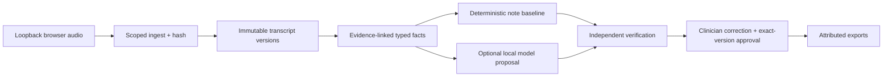

# Product architecture and evidence map

This page is the investor-demo architecture map for the local-first prototype.



## API examples

```http
GET /health
GET /v1/encounters/{encounter_id}/workspace
PATCH /v1/encounters/{encounter_id}/notes/{note_id}
POST /v1/encounters/{encounter_id}/approvals
POST /v1/encounters/{encounter_id}/exports
```

Every write is scoped to the tenant, clinician, encounter and current immutable
version. Approval requires the current note hash and verification receipt.

## Data lifecycle

Audio is ingested with a checksum, normalized into a separate working asset,
transcribed into immutable versions, converted into evidence-linked facts, and
drafted as a proposal. Verification findings remain blocking until a clinician
reviews and corrects them. Only an exact-version approval can produce exports;
amendments create a new version. Retention purge and backup expiry are separate
operator actions.

## Security and limitations

The [local threat model](local-threat-model.md) covers browser audio, workers,
prompts, model outputs, notes, exports and backups. The [runtime support
matrix](runtime-support-matrix.md) and [model-selection notes](model-selection.md)
document tested environments and model limits. All benchmarks retain failures,
the unchanged 5% normalized-WER gate, and `real_patient_release_authorized=false`.
This is not a clinical approval, compliance certification, independent clinical
study, or live Google/OIDC deployment.

## Model cards and reports

Dataset-specific cards are generated from the frozen reports in
`evaluation/reports/` and must retain language, runtime, decoding, failures,
timeouts, WER, role metrics and limitations. The [evaluation protocol](evaluation-protocol.md)
defines the source-of-truth and admission rules; hosted and missing-artifact
models remain visible but unranked or blocked.
