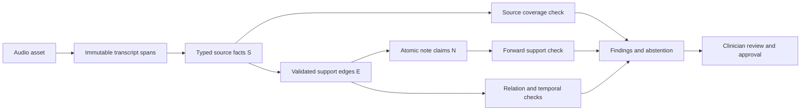

# BECCSV: a source-linked verification hypothesis for clinical note drafting

**Document type:** internal systems/method-hypothesis draft  
**Version:** 0.1  
**Status:** engineering development only; not a clinical study or efficacy report  
**Clinical release authorized:** no

## Abstract

Clinical note drafting systems can omit facts that were present in a
consultation or add claims that the source did not support. We specify
Bidirectional Evidence-Constrained Clinical State Verification (BECCSV), a
proposed method that represents source facts, note claims, and typed support and
consistency edges in a graph. It checks source-to-note coverage, note-to-source
support, and preservation of polarity, subject, temporality, certainty, and
medication relationships. Deterministic graph and rule checks remain the
approval gate; optional local model judgments cannot clear findings. We state a
paired, consultation-level hypothesis and a synthetic development protocol.
Current evidence is limited to software tests and seven synthetic metamorphic
checks. Two semantics-preserving transformations caused false alarms. No
frozen-baseline comparison or independent clinical evaluation has been run, so
the hypothesis remains untested.

## 1. Problem and contribution claim

A one-directional verifier can miss omitted source information if it only asks
whether existing note statements sound plausible. A model that critiques its
own draft can also agree with unsupported content. BECCSV makes the source and
note sides explicit and requires both directions of completeness.

The proposed contribution is an engineering method hypothesis: a typed,
evidence-linked graph plus conservative state checks may reduce critical
unsupported-claim and omission errors while keeping false alarms bounded. We do
not claim that this mechanism is novel relative to all prior work; a systematic
related-work review is still required. We do not claim clinical efficacy.

## 2. Method overview

For each consultation, let `S` be required source facts, `N` be atomic note
claims, and `E` be typed evidence and consistency edges. Source facts retain
exact transcript spans and state fields. Claims retain their origin and
source-fact IDs. Edges connect claims only when their evidence and typed state
checks pass.

The graph is validated without an LLM first. Optional model judgments are
advisory proposals and cannot mutate source facts, erase rule findings, or
approve a note. Existing implementation references are
`services/evidence_graph.py`, `services/review/relationships.py`, and
`services/review/clinical.py`. The protocol and algorithm are specified in
[`beccsv-protocol-v1.md`](beccsv-protocol-v1.md).

## 3. Hypothesis and planned comparisons

The preregistered hypothesis is that full BECCSV will reduce critical unsafe
claim misses by at least 20% relative to deterministic checks alone, while
increasing consultation-level false alarms by no more than 5 percentage points.
The comparison is paired by consultation and must meet the interval criteria in
the protocol. Qualified independent reviewers must approve the severity mapping
and false-alarm bound before an acceptance cohort is examined.

The planned baselines are: plain SOAP template with clinician review; ordinary
prompt-based drafting; deterministic checks only; LLM-only self-critique; and
deterministic checks plus an optional local verifier. Graph ablations remove
source coverage, temporal edges, relation edges, uncertainty/abstention,
deterministic rules, or the local verifier one at a time. All arms must share
the same locked cases and comparable resource, timeout, output, and retry
budgets. The machine-readable ablation matrix is marked declared, not executed.

## 4. Development artifacts and results

`evaluation/datasets/beccsv-synthetic-dev-v1/manifest.json` contains eight
synthetic text consultations with 24 typed source facts and 22 note claims. Its
lock prevents in-place case changes. A deterministic generator supplies five
additional development counterexamples for dose binding, polarity, subject, and
temporal changes. These materials are not clinical gold, are not independently
annotated, and are not authorized for acceptance use.

The current metamorphic report has seven cases: unit conversion, faithful
paraphrase, clause reordering, temporal flip, drug-dose swap, negation reversal,
and subject swap. Five passed the expected transformation behavior. The current
deterministic checks produced two false alarms: a faithful paraphrase was
flagged for omitted/unsupported terms, and clause reordering was flagged as a
clinical relationship disagreement. No semantic flip was missed in this small
development suite. These are test observations, not clinical rates.

Full BECCSV-versus-baseline comparisons and the six graph ablations have not
been run. The local Ollama client exists, but the local server was not running
when checked. There is no independent adjudicated acceptance cohort. No timeout
or aborted comparison was observed because no full comparison was started; this
must not be interpreted as zero timeouts. The current negative-results index is
[`beccsv-negative-results-index-v1.json`](../../evaluation/reports/beccsv-negative-results-index-v1.json).

## 5. Reproducibility and analysis

All current work is local. The development manifest and lock are versioned;
changed examples require a new dataset version. The intended primary endpoint
is consultation-level critical unsafe-claim miss rate, with failure-inclusive
denominators and a false-alarm bound. Secondary endpoints are source omission
coverage and note-claim provenance completeness. Confidence intervals are
clustered at original consultation; perturbation siblings and clips stay within
their parent cluster. A paired consultation bootstrap is planned, and 6–12
developer cases cannot support a significance claim.

The analysis will report raw numerators and denominators, false alarms,
omissions, unsupported claims, abstentions, timeouts, malformed responses,
resource deferrals, aborted runs, dataset changes, and contamination concerns.
No missing result is silently dropped or imputed.

## 6. Limitations and conclusion

The current work specifies the method and validates software properties on
synthetic cases. It does not establish that BECCSV improves note accuracy,
clinician workload, or patient safety. The deterministic rule layer has known
false alarms. The ablation matrix has no measured outcomes. No qualified
reviewers, independent acceptance cohort, or institutional approval have been
provided. A systematic literature review is also outstanding.

This draft is a **systems/benchmark/method hypothesis** document. Any future
clinical efficacy claim requires independent, appropriately governed studies
and separate authorization. No model promotion or real-patient release follows
from this work.
