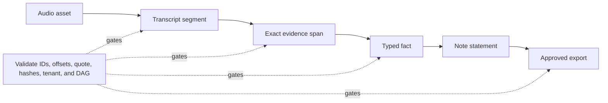
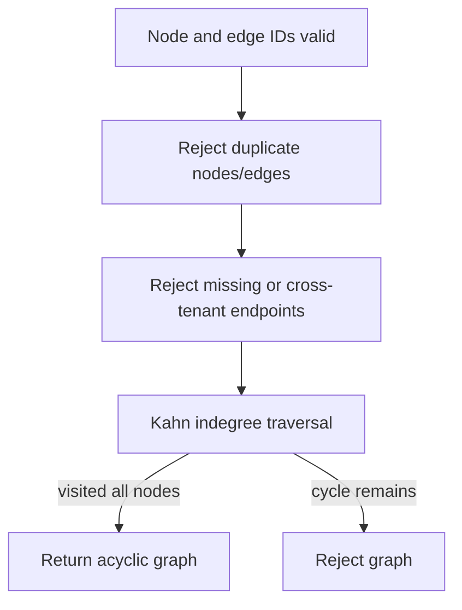

# Source-bound algorithm reference

**Source commit:** `6323e2c3c2d6388145166564a74f2bfc0104f68a`

Source files are SHA-256 bound below. Pseudocode was checked against actual function definitions and guard anchors; it is a summary, not executable code or proof of clinical correctness.

## evidence_proposal_graph

Implementation: `services/evidence_graph.py::validate_proposal`

1. Require transcript ID and audio asset ID.
2. Index transcript segments and reject duplicate segment IDs.
3. For each fact, require a unique fact ID, a known segment, integer offsets, and an exact source-text quote match.
4. Hash the transcript ID plus evidence span to identify a source span.
5. Add audio→segment, segment→span, and span→fact edges; deduplicate shared edges.
6. Validate graph node/edge invariants; return source hash and fact-level completeness only.

Source guards:

- `evidence_graph_source_required`
- `evidence_graph_duplicate_segment`
- `evidence_graph_invalid_source_link`
- `audio_to_transcript`
- `transcript_to_span`
- `span_to_fact`
- `complete_to_fact`
- `complete_to_export`

## directed_graph_invariants

Implementation: `services/evidence_graph.py::validate_graph_invariants`

1. Require a non-empty, duplicate-free node set.
2. For every edge, require present endpoints, an edge type, and a unique (from,to,type) tuple.
3. When tenant labels are supplied, require both endpoints to be labeled and to share a tenant.
4. Run Kahn's indegree queue traversal; reject unless every node is visited.
5. Return node count, edge count, and acyclic=true only after all checks pass.

Source guards:

- `evidence_graph_nodes_invalid`
- `evidence_graph_edge_node_missing`
- `evidence_graph_edge_duplicate`
- `evidence_graph_tenant_missing`
- `evidence_graph_cross_tenant_edge`
- `evidence_graph_cycle_detected`

## approved_export_hash_chain

Implementation: `services/evidence_graph.py::validate_approved_export`

1. Recompute transcript and note hashes; bind note to transcript ID/hash and approval to exact note/transcript IDs/hashes.
2. Require export ID and artifact hash; validate amendment parent linkage and hash when present.
3. Validate source-linked facts against transcript spans and build evidence edges.
4. Require note statements to reference known facts, then link fact→statement→export.
5. Validate the completed graph and return only after the exact approval/export chain is consistent.

Source guards:

- `evidence_graph_hash_chain_invalid`
- `evidence_graph_unexpected_amendment_parent`
- `evidence_graph_amendment_parent_invalid`
- `evidence_graph_note_fact_link_invalid`
- `evidence_graph_note_coverage_incomplete`
- `complete_to_export`

## directional_source_coverage

Implementation: `services/review/engine.py::directional_coverage`

1. Partition verifier findings into source-to-note and note-to-source code sets.
2. Keep finding ID, code, materiality, fact ID, and bounded source reference.
3. Summarize deterministic coverage receipts and manual facts without treating them as clinical gold labels.
4. Return directional findings; do not convert coverage into a clinical accuracy or false-alert rate.

Source guards:

- `source_omission`
- `critical_source_omission`
- `unaccounted_source_content`
- `note_not_in_source`
- `source_not_in_note`

## Evidence graph

## Directed graph invariants

## Source hashes

- `services/evidence_graph.py`: `bde2cb9b540308a8d96c90f90131a00661412517f45074df253e742548914e55`
- `services/review/engine.py`: `3177a67e0fe272932c95ede3b06b3bb4e114f25636d5d00ddca32cd1cada5dfe`

## Limitations

- Pseudocode summarizes source functions and is not executable code.
- Anchors prove the named guards/branches are present, not formal verification or clinical validity.
- This graph records provenance and consistency; it does not establish truth of source statements.
